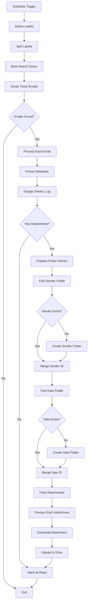

# ️ Workflow Architecture

## Final Drive Folder Hierarchy

```
 Google Drive
   └──  Root (configurable)
       │
       ├──  John Doe
       │   ├──  2026-08-29
       │   │   ├──  invoice_aug.pdf
       │   │   ├──  contract_v2.docx
       │   │   └── ️  signature.png
       │   ├──  2026-08-28
       │   │   └──  report.xlsx
       │   └──  2026-08-25
       │       └──  proposal.pdf
       │
       ├──  Jane Smith
       │   ├──  2026-08-29
       │   │   └──  meeting_notes.pdf
       │   └──  2026-08-27
       │       └──  budget.xlsx
       │
       └──  Acme Corporation
           ├──  2026-08-29
           │   ├──  order_001.pdf
           │   └──  shipping_label.png
           └──  2026-08-26
               └──  terms.pdf
```

## Google Sheets Row Schema

| Column         | Type    | Example                              |
|----------------|---------|--------------------------------------|
| Message ID     | String  | `18d4f2a1b3c9e0f5`                   |
| Thread ID      | String  | `18d4f2a1b3c9e0f5`                   |
| Sender Name    | String  | `John Doe`                           |
| Sender Email   | String  | `john.doe@example.com`               |
| Subject        | String  | `Q3 Report + Invoice`                |
| Date Received  | String  | `Fri, 29 Aug 2026 14:23:00 +0000`    |
| Snippet        | String  | `Please find attached...`            |
| Labels         | String  | `label1, Important`                  |
| Has Attachments| Boolean | `TRUE`                               |
| Source Label   | String  | `label1`                             |

## Why This Design?

| Decision                          | Rationale                                                            |
|-----------------------------------|----------------------------------------------------------------------|
| Schedule Trigger (not Webhook)    | Polls Gmail on cadence — no external trigger needed, fully self-driving |
| Split-out per label & per email   | Guarantees one execution path per item, no silent drops              |
| Code nodes for parsing            | Email headers are messy — JS handles edge cases cleanly              |
| HTTP nodes for Drive folders      | Native Drive node in older n8n versions lacks the folder-by-name flow |
| Find-or-create pattern            | Idempotent — re-running never duplicates folders                     |
| Mark as read at the end           | Same email never processed twice on the next run                     |
| `newer_than:1d` Gmail filter      | Bounded window — even if Mark-as-Read fails, no infinite loop        |

## Mermaid Diagram (for documentation sites)


