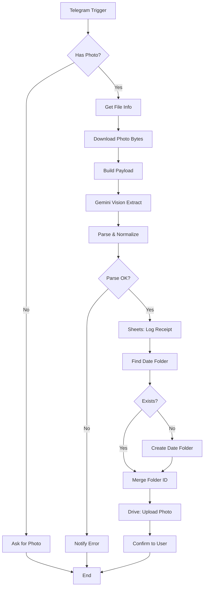

# 🏗️ Workflow Architecture

## Final Drive Folder Hierarchy

```
📁 Google Drive
   └── 📁 Receipt Inbox (root, configurable)
       │
       ├── 📁 2026-08-29
       │   ├── 🖼️ receipt_482391_20260829_184215.jpg
       │   ├── 🖼️ receipt_715290_20260829_213042.jpg
       │   └── 🖼️ receipt_1048273_20260829_225517.jpg
       │
       ├── 📁 2026-08-28
       │   ├── 🖼️ receipt_482391_20260828_091502.jpg
       │   └── 🖼️ receipt_1048273_20260828_194511.jpg
       │
       └── 📁 2026-08-27
           └── 🖼️ receipt_715290_20260827_123344.jpg
```

## Google Sheets Row Schema

| Column              | Type    | Example                              |
|---------------------|---------|--------------------------------------|
| Timestamp           | String  | `2026-08-29T18:42:15.123Z`           |
| Submission Date     | String  | `2026-08-29T18:42:15.000Z`           |
| Telegram User       | String  | `johndoe` or `John`                  |
| Telegram User ID    | String  | `482391`                             |
| Caption             | String  | `Lunch with client`                  |
| Merchant            | String  | `Whole Foods Market`                 |
| Merchant Address    | String  | `123 Main St, Springfield, IL`       |
| Receipt Date        | String  | `2026-08-29`                         |
| Receipt Time        | String  | `18:42`                              |
| Currency            | String  | `USD`                                |
| Subtotal            | Number  | `43.95`                              |
| Tax                 | Number  | `3.37`                               |
| Tip                 | Number  | `0.00`                               |
| Total               | Number  | `47.32`                              |
| Payment Method      | String  | `card`                               |
| Card Last 4         | String  | `4242`                               |
| Category            | String  | `meals`                              |
| Line Items          | Number  | `5`                                  |
| Line Items (JSON)   | String  | `[{"description":"Salad",...}]`      |
| Notes               | String  | `Client meeting — reimbursable`     |
| Photo File ID       | String  | `AgACAgIAAxk...`                     |
| Drive File Name     | String  | `receipt_482391_20260829_184215.jpg` |
| Submission Date Folder | String | `2026-08-29`                      |

## Why This Design?

| Decision                          | Rationale                                                            |
|-----------------------------------|----------------------------------------------------------------------|
| Telegram webhook trigger          | Real-time — user gets instant confirmation vs polling               |
| `getFile` → `HTTP /file/bot...`   | Two-step Telegram API to retrieve actual bytes                       |
| Gemini 1.5 Flash                  | Fastest vision model, free tier friendly, accurate on receipts      |
| `responseMimeType: application/json` | Forces structured output — no parsing markdown around JSON         |
| Strip markdown fences in Code     | Defensive: model occasionally ignores instructions, parser still works |
| Number normalization              | Gemini returns `"$12.50"` or `"12.50"` — coerce to real numbers    |
| `null` for missing fields         | Lets downstream analytics distinguish "missing" from "zero"         |
| Date folder on **submission** date| Stable — re-uploading same receipt never creates a new folder       |
| Telegram confirmation message     | UX loop — user knows immediately if OCR succeeded or failed          |
| Markdown formatting in reply      | Renders nicely in mobile Telegram app                                |

## Mermaid Diagram



## Gemini Prompt Engineering Notes

The prompt is engineered for **deterministic JSON output**:

1. **Schema explicit** — Lists every field name and type
2. **`null` for missing** — Prevents hallucinated values like fake store names
3. **`responseMimeType: application/json`** — Tells Gemini to skip markdown wrapping
4. **Low temperature (0.1)** — Reduces creative variation between runs
5. **"No commentary"** — Reduces preamble like "Here's the JSON:"
6. **Few-shot skip** — Receipts are uniform enough that schema-only is sufficient

The defensive parser in `Parse & Normalize Gemini Output` handles the cases where Gemini still wraps output in ```json fences — by stripping them before JSON.parse.
